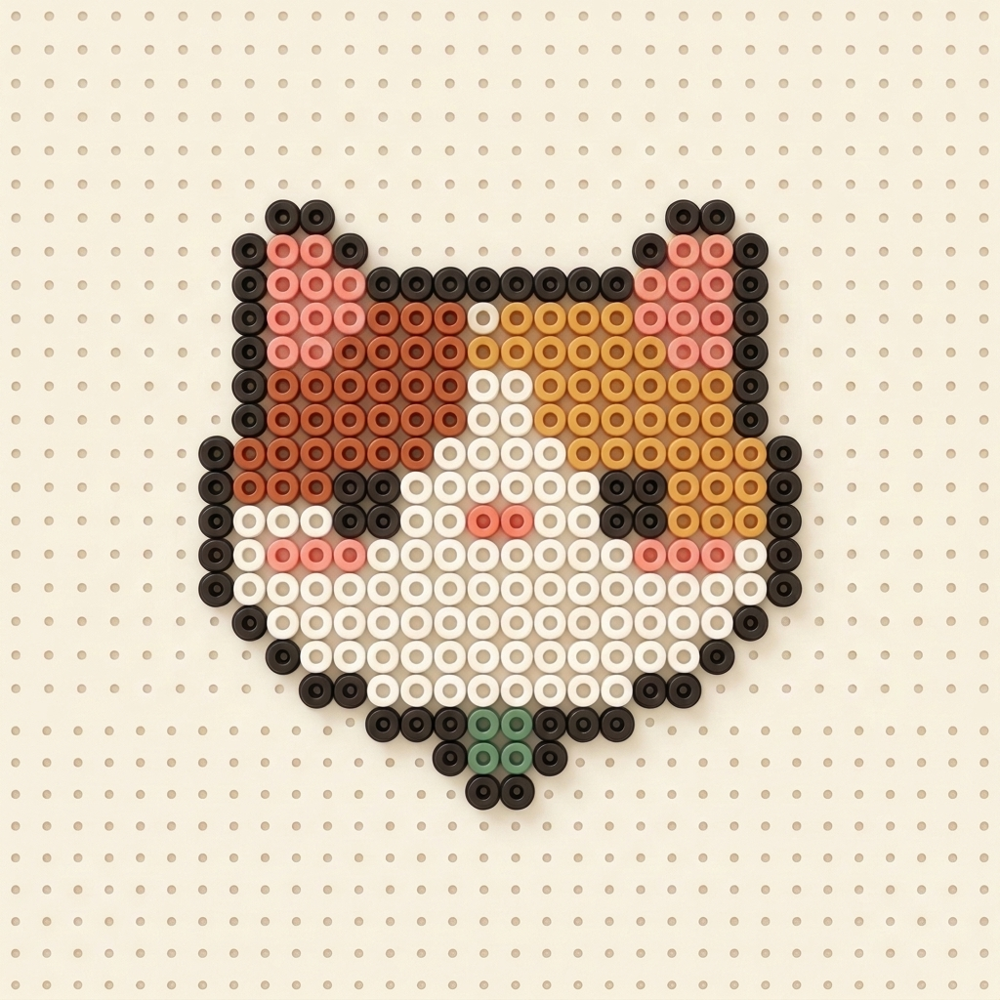
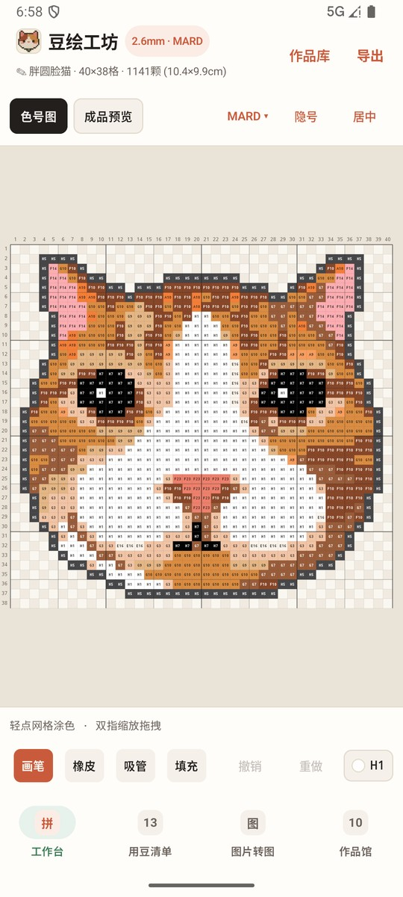
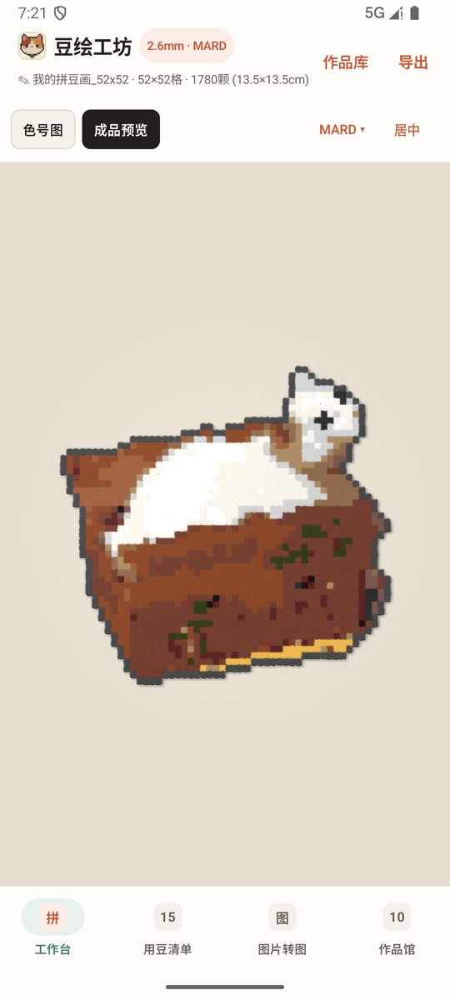
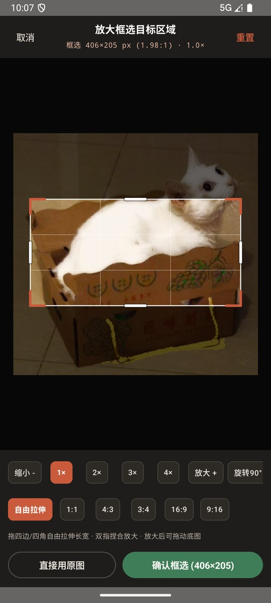
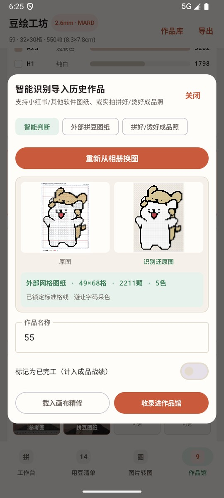
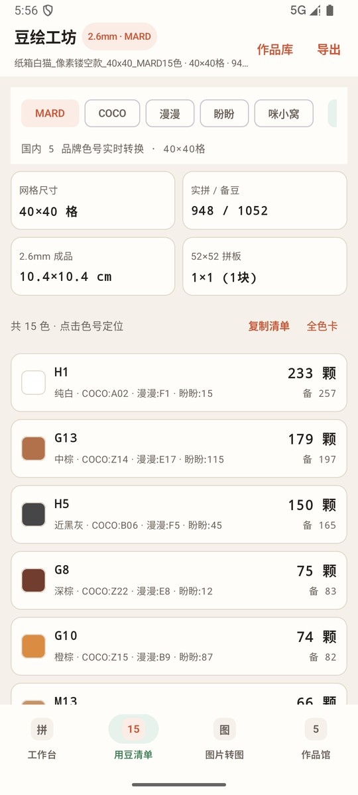
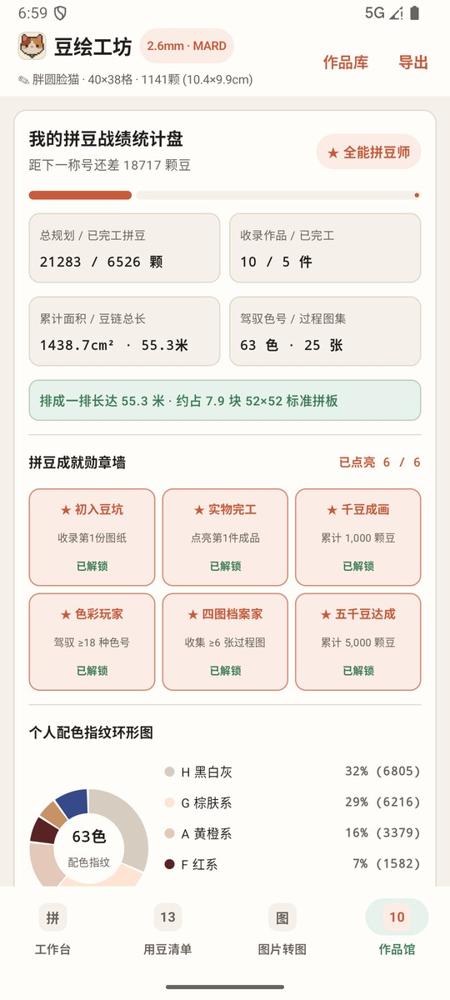

<p align="center">
  
</p>

<h1 align="center">豆绘工坊 · Pindou Studio</h1>

<p align="center">
  <strong>专为国内拼豆玩家打造的免费开源纯离线工坊</strong><br />
  拍照抠图转图纸 · 长方形自由拉伸框选 · 历史图纸 / 成品智能识别 · 五大品牌色号实时互转
</p>

<p align="center">
  <a href="https://github.com/LEFTX1/pindou-studio/releases/latest">
    
  </a>
  <a href="https://github.com/LEFTX1/pindou-studio/releases">
    
  </a>
  
  
  
</p>

<p align="center">
  <a href="#-界面一览--真机实拍">界面预览</a> ·
  <a href="#-核心亮点">核心亮点</a> ·
  <a href="#-免费下载与安装">免费下载</a> ·
  <a href="#-项目目录与开发者构建">目录与构建</a> ·
  <a href="#-请作者喝杯咖啡--支持独立开发">☕ 请作者喝杯咖啡</a>
</p>

---

## 💡 为什么做「豆绘工坊」？

做拼豆本是一件很治愈的手作，但市面上的拼豆工具常常让人劝退——要么开屏广告满天飞、导出一张高清图纸要开会员；要么只支持海外 Perler / Hama 色号，没有国内玩家常用的 **MARD / COCO / 漫漫 / 盼盼 / 咪小窝** 对照；要么被限制成死板的正方形比例，连横版猫咪或竖版挂件都裁不舒服。

作为一个喜欢写点小工具的独立开发者，我干脆自己用 **Kotlin + Jetpack Compose** 从零搓了这个 **不到 4.4 MB、纯离线、零广告、无需登录** 的小工坊——所有照片算法、图纸识别和作品存档全部在你自己手机本地完成，把原本的快乐还给拼豆本身。

---

## 📱 界面一览 · 真机实拍

<table>
  <tr>
    <td align="center" width="33%">
      <br />
      <sub><strong>🎨 高清色号画布工作台</strong><br />画笔 / 橡皮 / 吸管 / 填充 / 撤销重做</sub>
    </td>
    <td align="center" width="33%">
      <br />
      <sub><strong>🔥 实拍抠底 + 2.6mm 热熨预览</strong><br />测地线轮廓抠底 · 烘焙油纸平融质感</sub>
    </td>
    <td align="center" width="33%">
      <br />
      <sub><strong>✂️ 长方形自由拉伸放大框选</strong><br />四边独立拖拽 · 双指缩放 · 比例自适应</sub>
    </td>
  </tr>
  <tr>
    <td align="center" width="33%">
      <br />
      <sub><strong>🔍 历史图纸 / 成品智能识别</strong><br />自动定格 · 剥离标尺 · 避让字码采色</sub>
    </td>
    <td align="center" width="33%">
      <br />
      <sub><strong>🧮 五大品牌实时换算清单</strong><br />MARD / COCO / 漫漫 / 盼盼 / 咪小窝 +10%备豆</sub>
    </td>
    <td align="center" width="33%">
      <br />
      <sub><strong>🏆 作品馆与成就战绩盘</strong><br />6大勋章墙 · 配色指纹环 · 四图档案对比</sub>
    </td>
  </tr>
</table>

---

## ✨ 核心亮点

- **🪄 纯离线拍照转拼豆（告别偏绿与断脖抠图）**
  - 提供「**照片融合精修**」与「**异形描边镂空**（自动抠底 + 1 格 H5 炭灰描边）」双模式；
  - 针对宠物实拍优化：内置**白毛偏绿自动抑制**（自动避开 G15 / H18 / M1-7 等偏绿色阱）、**圆眼配对对称抗锯齿**，以及基于测地线与多轴凹陷桥接的轮廓抠图（解决猫咪阴影脖颈误切）。
- **✂️ 长方形自由拉伸框选 · 系统相册直达**
  - 全场景默认直接调起手机**原生系统相册**（告别繁琐文件管理器），自动矫正 EXIF 横竖拍方向；
  - 支持双指缩放（`1× ~ 6×`）、`90°` 旋转与四边自由拉伸长宽，并支持「**按裁剪比例自适应长方形格数**」（例如框选 `2:1` 区域自动匹配 `40×20` 格），同时提供独立宽高滑块（`12 ~ 96` 格）与 `29 / 40 / 48 / 52 / 72` 最长边预设。
- **🧩 历史外部图纸 & 成品照一键还原**
  - 在小红书、其他生成器保存过带字码网格图？或以前拼好/烫好但丢了图纸？
  - 离线自动完成网格周期锁定、坐标标尺剥离、**避让色号文字内环中位采色**，以及实物照桌面去底还原，直接导入画布继续精修。
- **🏷️ 国内五大品牌 221 色实时互转 & 全套导出**
  - 内置国内标准 221 基准色卡，一键在 **MARD / COCO / 漫漫 / 盼盼 / 咪小窝** 间实时切换；
  - 支持 `2.6mm`（52 板）/ `5.0mm`（29 板）尺寸与厘米换算，一键导出高清 PNG 施工图、JPG 热熨效果图、五品牌 CSV 采购清单及 `.pindou.json` 可编辑工程。
- **🏆 作品馆四图档案与成就统计盘**
  - 每件作品支持选填关联【参考图 / 拼豆图纸 / 拼好的图 / 烫好的图】4 个过程槽位并支持点击大图对照；
  - 自动累计总拼豆数、完工面积与豆链长度，解锁 **6 大成就勋章**，生成专属配色指纹环形图与用豆量排行，支持随时重命名。

---

## 📥 免费下载与安装

> **安装包体积约 4.3 MB · 支持 Android 8.0 及以上 · 永久免费 · 无广告 · 无内购 · 无需联网与登录**  
> 安装后在 App 右上角点击「**作品库 → 检查更新**」，即可免梯通过国内加速镜像一键检测并校验 SHA-256 升级，保留全部历史作品数据。

| 下载渠道 | 适用网络 | 直达链接 |
| :--- | :--- | :--- |
| 🚀 **国内加速镜像 1（推荐）** | 国内直连 | [立即下载 v1.2.4 正式签名 APK (ghfast)](https://ghfast.top/https://github.com/LEFTX1/pindou-studio/releases/download/v1.2.4/pindou-studio-v1.2.4-release.apk) |
| ⚡ **国内加速镜像 2（备用）** | 国内直连 | [立即下载 v1.2.4 正式签名 APK (gh-proxy)](https://gh-proxy.com/https://github.com/LEFTX1/pindou-studio/releases/download/v1.2.4/pindou-studio-v1.2.4-release.apk) |
| 🌐 **GitHub Releases 官方发布页** | 全部版本与更新日志 | [前往 Releases 页面](https://github.com/LEFTX1/pindou-studio/releases/latest) |

---

## ☕ 请作者喝杯咖啡 · 支持独立开发

**豆绘工坊完全免费、无广告、不做会员收费。**  
这个 App 都是我利用业余时间一点点打磨功能、真机跑图调算法做出来的，后续还会继续迭代更多玩家呼声高的实用能力（比如分区拼豆引导、分块大板拼接预览、更多色系扩展等）。

如果它正好帮你省下了找图纸、对齐色号的时间，或者让你愉快地完成了一件满意的拼豆作品：
- 欢迎点亮右上角一颗 **⭐ Star**，这就是对独立开发者最大的鼓励；
- 如果愿意请作者喝一杯咖啡 / 奶茶 ☕，扫码随喜支持，非常感谢你的每一份喜欢！

<table>
  <tr>
    <td align="center" width="50%">
      <br />
      <strong>💚 微信扫一扫 · 请喝杯咖啡</strong>
    </td>
    <td align="center" width="50%">
      <br />
      <strong>💙 支付宝扫一扫 · 请喝杯咖啡</strong>
    </td>
  </tr>
</table>

---

## 📂 项目目录与开发者构建

<details>
<summary>点击展开仓库目录结构与本地构建命令（适合开发者）</summary>

```text
pindou-studio/
├── android-app/          # Android 客户端（Kotlin + Jetpack Compose）
├── web-studio/           # 本地 Python Web 工坊、CLI、核心算法库与单测
│   ├── app/              # FastAPI 后端与前端页面
│   ├── pindou_core/      # MARD 221 标准色卡、量化算法与导出模块
│   ├── tests/            # 自动化单元测试
│   ├── run_app.py        # Web 工坊启动入口
│   ├── pindou_cli.py     # 命令行工具
│   └── launch_app.bat    # Windows 一键启动脚本
├── docs/                 # Logo、真机预览截图与赞赏码资源
├── scripts/              # Release 更新清单生成脚本
├── update/               # 在线热更新清单（version.json）
├── .gitignore
└── README.md
```

- **Android 客户端编译**：
  ```bash
  cd android-app
  ./gradlew assembleRelease
  ```
- **Python Web 工坊与单测**：
  ```bash
  python web-studio/run_app.py
  python -m unittest discover -s web-studio/tests -v
  ```

</details>

---

<p align="center">
  遇到 Bug 或有新功能建议？欢迎直接提交 <a href="https://github.com/LEFTX1/pindou-studio/issues">GitHub Issues</a> 💬<br />
  如果「豆绘工坊」对你的拼豆时光有帮助，别忘了点个 ⭐ <strong>Star</strong> 支持一下！
</p>
